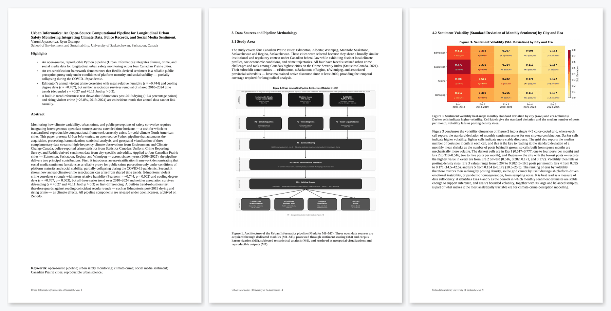

# Urban Informatics

**An open-source Python pipeline integrating climate, crime, and social media sentiment data for longitudinal urban safety monitoring across Canadian Prairie cities.**

---

## Read the Paper

[](docs/Urban-Informatics-manuscript.pdf)

**[Read the full manuscript (PDF, 35 pages)](docs/Urban-Informatics-manuscript.pdf)** — opens in GitHub's built-in viewer, so you can scroll through the whole paper in your browser without downloading it. FULL download - [`Urban Informatics - final formatted.docx`](Urban%20Informatics%20-%20final%20formatted.docx).

---

## Overview

`Urban Informatics` is a reproducible Python pipeline that automates the acquisition, processing, harmonisation, statistical analysis, and geospatial visualisation of three complementary open data streams:

- **Climate observations** — Environment and Climate Change Canada (ECCC) Historical Climate Data Portal
- **Crime statistics** — Statistics Canada Uniform Crime Reporting (UCR) Survey (Table 35-10-0177-01)
- **Social media sentiment** — Reddit posts from city-specific subreddits (via the PullPush archive for 2009–2013 and the Reddit API for 2014–2025)

Applied to four Canadian Prairie cities — **Edmonton**, **Saskatoon**, **Regina**, and **Winnipeg** — across sixteen years (2009–2025), the pipeline produces:

1. An **era-stratification framework** identifying when Reddit-derived sentiment is and is not a reliable proxy for public safety perception

2. **Climate-crime correlation and regression results** by city, with a trend-robustness check (detrended and first-difference correlations)

3. **Geospatial visualisations** of crime intensity and sentiment change across the Prairie region

4. **Reproducible statistical test outputs** for all tests reported in the article

---

## Repository Structure

```
Urban-Informatics/
│
├── README.md
├── requirements.txt                 # Pinned Python dependencies
├── LICENSE
├── Urban Informatics - final formatted.docx   # Manuscript (Word)
│
├── docs/
│   ├── Urban-Informatics-manuscript.pdf       # Manuscript (PDF, viewable on GitHub)
│   └── manuscript-preview.png                 # README preview image
│
├── scripts/
│   ├── figures/
│   │   ├── generate_figures.py          # Produces Figures 2–8 from raw CSVs
│   │   └── fig1_pipeline_architecture.py # Produces Figure 1 (no data required)
│   │
│   └── analysis/
│       ├── statistical_analysis.py      # Runs all tests + subreddit-mapping sensitivity
│       └── run_statistical_tests.py     # Runs tests and prints formatted tables
│
├── data/
│   ├── climate/
│   │   ├── Master_All_Cities_Daily_Climate_2010_to_2025_imputed.csv
│   │   ├── Master_All_Cities_Monthly_Climate_2010_to_2025_imputed.csv
│   │   └── Master_All_Cities_Yearly_Climate_2010_to_2025_imputed.csv
│   │
│   ├── crime/
│   │   ├── Actual_Incidents_Edmonton.csv
│   │   ├── Actual_Incidents_Regina.csv
│   │   ├── Actual_Incidents_Winnipeg.csv
│   │   └── Actual_Incidents_incidents Saskatoon.csv
│   │
│   └── sentiment/
│       ├── reddit_2009_2013_posts_sentiment.csv
│       ├── reddit_climate_crime_2009_2013_sentiment.csv
│       ├── reddit_climate_crime_2014_2019_sentiment.csv
│       ├── reddit_climate_crime_2020_2021_sentiment.csv
│       ├── reddit_climate_crime_2022_2023_sentiment.csv
│       ├── reddit_climate_crime_2024_2025_sentiment.csv
│       ├── reddit_2009_2013_for_gis.csv
│       ├── reddit_2014_2019_for_gis.csv
│       ├── reddit_2020_2021_for_gis.csv
│       ├── reddit_2022_2023_for_gis.csv
│       └── reddit_2024_2025_for_gis.csv
│
└── data_acquistion/
    ├── redditscraper_2009_2013.py
    ├── redditscraper_2014_2019.py
    ├── redditscraper_2020_2021.py
    ├── redditscraper_2022_2023.py
    ├── redditscraper_2024_2025.py
    ├── reddit_common.py             # Shared steps for the 2014–2023 collectors
    ├── sentiment_2009_2013.py       # Filters + VADER-scores Era 1 posts
    ├── acquistion_edmonton.py
    ├── acquistion_regina.py
    ├── acquistion_saskatoon.py
    ├── acquistion_winnipeg.py
    ├── masterclimate_acquistion.py
    └── impute_climate.py            # Imputes daily climate; builds monthly/yearly
└── figures/
    ├── fig1_pipeline_architecture.png
    ├── fig2_rolling_sentiment.png
    ├── fig3_volatility_heatmap.png
    ├── fig4_climate_crime_scatter.png
    ├── fig5_proportional_maps.png
    ├── fig6_era_comparison.png
    ├── fig7_spatial_sentiment.png
    └── fig8_polar_seasonal.png
├── raw_data/
│   ├── Master_Data/
│   │   ├── Actual_Incidents_Edmonton.csv
│   │   ├── Actual_Incidents_Regina.csv
│   │   ├── Actual_Incidents_Winnipeg.csv
│   │   ├── Actual_Incidents_incidents Saskatoon.csv
│   │   ├── Master_All_Cities_Daily_Climate_2010_to_2025_imputed.csv
│   │   ├── Master_All_Cities_Monthly_Climate_2010_to_2025_imputed.csv
│   │   ├── Master_All_Cities_Yearly_Climate_2010_to_2025_imputed.csv
│   │   ├── reddit_2009_2013_for_gis.csv
│   │   ├── reddit_2014_2019_for_gis.csv
│   │   ├── reddit_2020_2021_for_gis.csv
│   │   ├── reddit_2022_2023_for_gis.csv
│   │   ├── reddit_2024_2025_for_gis.csv
│   │   ├── reddit_climate_crime_2009_2013_sentiment.csv
│   │   ├── reddit_climate_crime_2014_2019_sentiment.csv
│   │   ├── reddit_climate_crime_2020_2021_sentiment.csv
│   │   ├── reddit_climate_crime_2022_2023_sentiment.csv
│   │   └── reddit_climate_crime_2024_2025_sentiment.csv
│   │
│   ├── climate/
│   │   ├── edmonton/
│   │   ├── regina/
│   │   ├── saskatoon/
│   │   ├── winnipeg/
│   │   ├── master_raw/
│   │   ├── master_cleaned/
│   │   └── master_imputed/
│   │
│   ├── crime/
│   │   ├── edmonton/
│   │   ├── regina/
│   │   ├── saskatoon/
│   │   ├── winnipeg/
│   │   └── crime_metrics/
│   │
│   └── social_media/
│       ├── 2009-2013_sentiment/
│       ├── 2014-2019_Reddit_Ramp_Up/
│       ├── 2020-2021_Pandemic_Era/
│       ├── 2022-2023_API_Change/
│       └── 2024-2025_stabilizationperiod/
```

---

## Pipeline Architecture (M1–M7)

| Module | Name | Description |
|--------|------|-------------|
| M1 | Climate Acquisition | Priority-ordered station fallback (one station per city in practice), city-month imputation, HDD/CDD derivation |
| M2 | Crime Integration | UCR violation mapping, annual aggregation to city level |
| M3 | Reddit Corpus Collection | Keyword classification, subreddit mapping, 2009–2025 |
| M4 | Sentiment Scoring | VADER compound scoring (all eras), categorical classification, crime-relevance filtering |
| M5 | Corpus Harmonisation & Bias Checks | Era-consistent inclusion rule (crime or weather keywords), subreddit-to-city mapping, volume-bias check |
| M6 | Statistical Analysis | Kruskal-Wallis, Mann-Whitney U, Chi-square, Pearson, OLS regression, trend robustness |
| M7 | Geospatial Visualisation | Maps, polar charts, heatmaps, scatter panels, era comparison charts |

---

## Installation

Requires Python 3.11 or newer (tested on Python 3.14).

```bash
pip install -r requirements.txt
```

[`requirements.txt`](requirements.txt) pins the exact package versions used to produce the results in the article:

| Package | Version | Used for |
|---------|---------|----------|
| pandas | 2.3.3 | Data loading and processing (all scripts) |
| numpy | 2.3.4 | Numerical work in the analysis and figure scripts |
| scipy | 1.16.3 | Statistical tests |
| matplotlib | 3.10.7 | Figures 1–8 |
| requests | 2.32.5 | ECCC climate downloads and the PullPush archive (Era 1) |
| praw | 7.8.1 | Reddit API collectors |
| prawcore | 2.4.0 | Reddit API error handling in the collectors |
| vaderSentiment | 3.3.2 | VADER sentiment scoring (all eras) |
| python-dotenv | 1.2.1 | Loading Reddit API credentials from a `.env` file |

To reproduce the statistics and figures only, the first four packages are enough; the rest are needed to re-collect or re-score the raw data.

---

## Reproducing the Figures

### Figure 1 — Pipeline Architecture Diagram
```bash
python scripts/figures/fig1_pipeline_architecture.py
```
No data files required. Outputs `figures/fig1_pipeline_architecture.png`.

### Figures 2–8 — All Data Figures
```bash
python scripts/figures/generate_figures.py
```

Paths are resolved relative to the repository, so no configuration is needed.

All seven figures are generated in a single run. Expected runtime: under 60 seconds on a standard laptop.

---

## Reproducing the Statistical Tests

```bash
python scripts/analysis/run_statistical_tests.py
```

Paths are resolved relative to the repository. The script runs all tests in sequence and prints formatted tables to the console, matching Tables 1–8 of the article. `statistical_analysis.py` runs the same tests and adds a sensitivity check with the provincial subreddits (r/alberta, r/saskatchewan, r/manitoba) dropped.

Every era uses the same inclusion rule: posts matching the crime or weather keyword sets. The 2020–2021 collector also kept pandemic-keyword posts; these are excluded so Era 3 is comparable with the other eras.

**Tests run:**
- Test 1: Kruskal-Wallis H (inter-city polarity distributions)
- Test 2: Mann-Whitney U with Bonferroni correction (pairwise city comparisons)
- Test 3: Chi-square test of independence (categorical sentiment composition)
- Test 4: Mann-Whitney U (crime vs. non-crime sentiment divergence, all posts)
- Test 5a: Pearson correlations (bivariate climate-crime)
- Test 5b: OLS regression + Durbin-Watson (multivariate climate-crime)
- Test 5c: Trend robustness (detrended and first-difference climate-crime correlations)


## Data Sources

| Dataset | Source | Years | Access |
|---------|--------|-------|--------|
| Climate (daily/monthly/yearly) | Environment and Climate Change Canada | 2010–2025 | [climate.weather.gc.ca](https://climate.weather.gc.ca) |
| Violent crime (UCR) | Statistics Canada Table 35-10-0177-01 | 2010–2024 | [statcan.gc.ca](https://www.statcan.gc.ca) |
| Reddit sentiment (Eras 1–5) | PullPush archive (2009–2013) + Reddit API (2014–2025) | 2009–2025 | Archived on Zenodo (DOI: https://doi.org/10.5281/zenodo.20161031) |

All processed datasets used in this study are archived on Zenodo under CC BY 4.0:
**DOI: https://doi.org/10.5281/zenodo.20161031**

---

## Era-Stratification Framework

The pipeline identifies five analytically distinct eras in the 2009–2025 Reddit data:

| Era | Period | Status |
|-----|--------|--------|
| Era 1 | 2009–2013 | Descriptive only — sparse (14–136 posts per city) |
| Era 2 | 2014–2019 | First analytically tractable era |
| Era 3 | 2020–2021 | Excluded — pandemic disruption |
| Era 4 | 2022–2023 | Post-pandemic re-stabilisation |
| Era 5 | 2024–2025 | Most analytically stable era |

---

## Key Findings

- **Edmonton**'s annual violent crime correlates with mean humidity (r = −0.744, p = 0.002) and cooling degree days (r = +0.707, p = 0.003), but neither association survives removal of the shared 2010–2024 trend (detrended r = +0.27 and +0.11, both p > 0.3). No city shows a trend-robust climate-crime association.

- Edmonton's post-2019 drying (−7.4 percentage points) and rising violent crime (+26.8% over 2019–2024; +49.8% over 2010–2024) are coincident trends that annual data cannot link causally

- **Winnipeg** shows no climate-crime associations despite the highest cooling degree days of any city (207/yr)

- **Regina** maintains a persistently positive sentiment profile across all five eras despite high per-capita crime severity — a discourse anomaly confirmed by Bonferroni-corrected Mann-Whitney U comparisons in Eras 2 and 4, and robust to dropping the provincial subreddits

- During the pandemic (Era 3), crime vs. non-crime divergence is lost in Regina (p = 0.111) and Winnipeg (p = 0.268) but retained in Edmonton and Saskatoon (p < 0.001), and no inter-city test is significant; that inter-city convergence depends on pooling the provincial subreddits

---

## Citation

> Jayasooriya, V., & Ocampo, R. (2026). *Climate Variability, Urban Crime, and Public Perceptions of Safety: A Social Media Sentiment Analysis of Canadian Prairie Cities*. Computers, Environment and Urban Systems.

---

## Licence

- **Data:** CC BY 4.0 — see Zenodo archive
